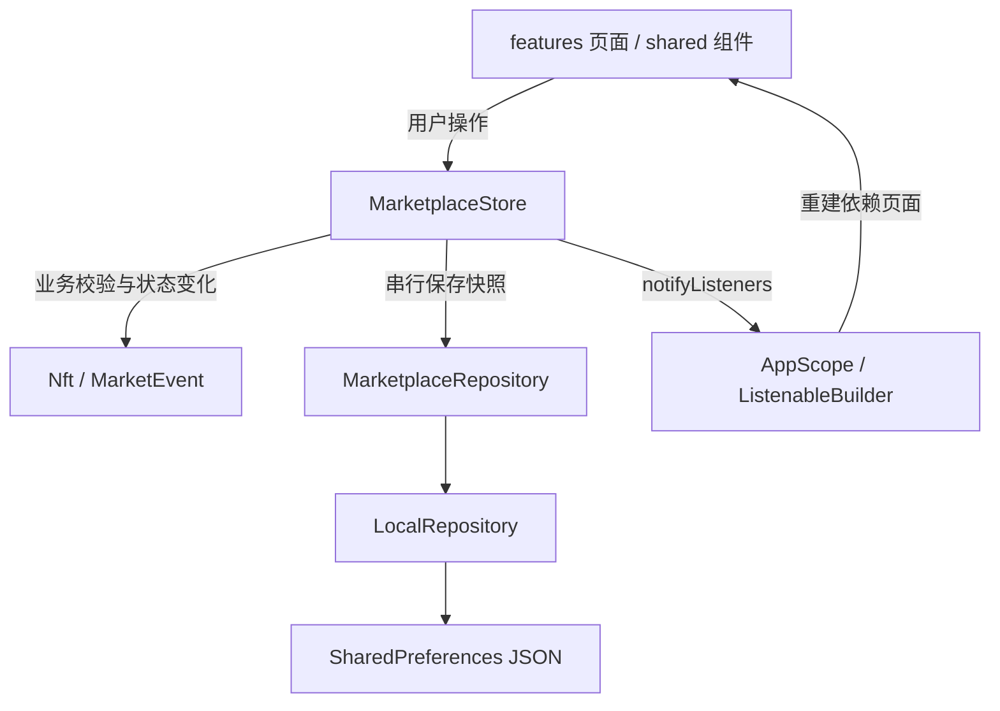

# CoralSea Flutter 项目结构与架构说明

## 1. 项目定位

基于 Pixso 文件 **CoralSea NFT UI KIT** 的移动端 NFT 市场演示应用，包含 Android、iOS 和 Web 工程。界面沿用原稿的黄色主色、Plus Jakarta Sans 字体、圆角作品卡片、居中创建按钮和明暗主题。作品图、头像、Logo、个人页封面、引导页图均通过 Pixso MCP 导出，运行时不依赖网络图片。

本交付实现本地可交互演示：钱包连接、余额、购买、报价、作品创建和通知均为模拟行为。没有连接链上合约、WalletConnect、支付网关或业务服务端；不会要求私钥或助记词。

## 2. 目录结构

```text
CoralSea NFT UI/
├── lib/
│   ├── main.dart                       # 初始化本地仓库并启动
│   ├── app.dart                        # MaterialApp、主题和依赖入口
│   ├── core/
│   │   └── theme.dart                  # 色彩、字体、输入框、按钮主题
│   ├── domain/
│   │   └── models.dart                 # Nft / MarketEvent、种子数据、分类
│   ├── data/
│   │   └── local_repository.dart       # 仓库接口与 SharedPreferences 实现
│   ├── state/
│   │   └── marketplace_store.dart      # 业务状态、校验、持久化队列、AppScope
│   ├── shared/
│   │   └── widgets.dart                # 卡片、网格、头像、分类条、通用页面
│   └── features/
│       ├── marketplace/
│       │   ├── marketplace_shell.dart  # 四个主导航与居中创建入口
│       │   ├── home_screen.dart        # 首页、卖家排行
│       │   ├── browse_screens.dart     # 分类、价格排序、搜索
│       │   └── detail_screen.dart      # 详情、四类信息、放大、分享、举报
│       ├── create/
│       │   └── create_screen.dart      # 创建作品、相册选择、表单与成功状态
│       ├── profile/
│       │   ├── profile_screen.dart     # 收藏/创建/喜欢/活动/报价、卖家主页
│       │   └── settings_screen.dart    # 设置、通知开关、FAQ
│       └── wallet/
│           ├── onboarding_screen.dart # 引导、模拟钱包、地址校验
│           ├── checkout_screen.dart   # 购买/报价表单、确认和成功状态
│           └── wallet_screen.dart     # 余额、复制地址、模拟收发/充值/包装
├── assets/
│   ├── images/                        # Pixso 导出的独立素材
│   └── fonts/                         # 本地字体及 OFL 授权
├── design_reference/                  # Pixso 关键页面参考图
├── docs/                              # 架构、设计映射、验证记录与实机截图
├── test/                              # 状态规则与界面测试
├── integration_test/                  # 模拟器端到端测试
├── test_driver/                       # 集成测试截图写入本地
├── android/ ios/ web/                 # 平台工程
└── pubspec.yaml / pubspec.lock         # 依赖声明与锁定
```

## 3. 架构和数据流

采用适合本项目规模的轻量分层，业务按功能组织。Flutter 原生 `ChangeNotifier` 与 `InheritedNotifier` 完成状态发布和依赖传递，不增加状态管理和路由框架。



- **UI 层**负责布局、路由、输入和页面短期状态。分类选择、搜索输入、当前详情标签和表单控制器由页面持有。
- **Store 层**负责收藏、余额、持有作品、报价记录、创建作品、钱包连接状态、主题及通知偏好。页面不直接写入本地存储。
- **模型层**提供不可变作品及活动记录和 JSON 转换。
- **仓库层**隐藏存储实现，便于测试注入和后续替换为远程 API。

初始化时先读取本地快照，再启动界面，避免主题闪烁。每次状态变化后立即更新 UI，并将独立快照加入串行写入队列，避免快速收藏或切换主题时旧写入覆盖新状态。保存失败保留会话状态并显示可重试提示。

参考 [Flutter 官方架构指南](https://docs.flutter.dev/app-architecture/guide) 的状态与数据访问分层原则；当前规模不增加 UseCase、代码生成、服务定位器等中间层。

## 4. 页面与导航

首次启动进入引导页，可连接模拟钱包，也可跳过。引导完成状态会保存。主界面使用 `IndexedStack` 保留首页、分类、搜索和个人中心的滚动位置及输入状态；详情、设置、钱包、创建和结算使用原生 Navigator 路由。

| 模块 | 已实现行为 |
| --- | --- |
| 首页 | 横向新作品、分类切换、卖家列表、热门网格、通知入口 |
| 分类与搜索 | 分类过滤、价格升降序、名称/作者/合集搜索、无结果状态 |
| 作品详情 | 作品放大缩放、收藏、所有者、倒计时、概览/报价/上架/活动切换 |
| 购买 | 钱包检查、演示确认、余额校验、防重复购买、收藏与活动更新 |
| 报价 | 金额校验、1/3/7/30 天期限、个人页报价历史；不锁定演示资金 |
| 创建 | 示例图片或相册、名称/价格/版税校验、固定价/竞价、新合集、分类、属性、替代文本 |
| 个人中心 | 已购买、已创建、已喜欢、活动、已报价，空状态 |
| 钱包 | Metamask/Rainbow 演示连接、合法地址连接、地址复制、模拟余额操作 |
| 设置 | 明暗主题、通知偏好、FAQ、应用信息、断开钱包 |
| 分享与举报 | 复制作品信息、会话内举报确认，不调用外部平台 |

详情倒计时是演示计时器，每次进入从预设时长开始；卖家、排行与默认作品由本地种子数据提供。卖家关注状态仅在当前页面保留。

## 5. 持久化与业务约束

使用键 `coralsea.marketplace.v1` 保存 JSON：引导状态、钱包标识、ETH/wETH 演示余额、主题、通知开关、收藏 ID、持有作品 ID、创建作品和活动历史。

购买在修改余额前完成连接、持有状态及余额校验。报价校验有限正数、可用余额和未来到期时间。创建表单在提交时也直接校验控制器值，确保滚动离屏字段仍参与校验。创建后的作品进入同一个目录，搜索、详情和个人页共用数据源。

相册图片压缩至最长边 1024px，压缩后不超过 2 MB，使用 Base64 随演示快照保存。该方式适合少量演示作品；正式产品应将图片移至文件缓存/对象存储，将大量结构化数据移至 SQLite 等存储，并增加上传进度、缓存与分页。

演示余额使用限制到六位小数的 `double`。真实链上金额必须改为最小单位整数（如 Wei），并由服务端/链上确认结果驱动状态，不能沿用客户端直接扣款逻辑。

## 6. 视觉与适配

主色 `#FFBB00`，浅色背景 `#FDFDFD`，深色背景 `#1F2937`。正文、标题、卡片和输入框样式集中在 `core/theme.dart`。字体本地打包，避免启动时下载。

基准设计为 375px 宽，遵守安全区；卡片按实际可用宽度计算尺寸，超过 500px 内容宽度使用三列。大屏上内容宽度限制为 600px。创建及结算页面可滚动并避让键盘。图片支持语义描述，底部导航具备按钮标签。

## 7. 代码精简策略

统一作品模型与目录；首页、搜索、个人页复用同一卡片和网格。购买与报价复用一个结算页，钱包操作复用一个表单；明暗主题共用布局。保持 2 个生产环境第三方依赖：`shared_preferences` 和 `image_picker`。测试依赖不打包到正式应用中。

保留有业务含义的分层与组件，避免为每一个按钮建立文件、重复定义 DTO、复制明暗两份页面，或为本地演示加入空的网络请求层。

## 8. 后续接入正式服务

1. 实现远程 `MarketplaceRepository`，将启动加载改为异步状态，补充加载、失败与重试状态。
2. 将目录与用户会话拆分为独立仓库，加入分页和搜索 API，替换种子数据。
3. 引入钱包连接和签名服务，只存公开地址/会话引用；敏感材料交由钱包处理。
4. 将购买、报价、铸造迁移至服务端/链上确认流程，增加待确认、失败、取消与重试状态。
5. 替换图片 Base64 持久化，接入上传、存储权限和图片审核流程。
6. 接入真实通知、社交分享、举报服务；当前界面已明确演示行为。

iOS 工程和相册用途说明已生成；需在 macOS/Xcode 环境另行编译、签名和实机验证。Android 当前发布配置使用调试签名，正式上架前须配置独立发布证书。
